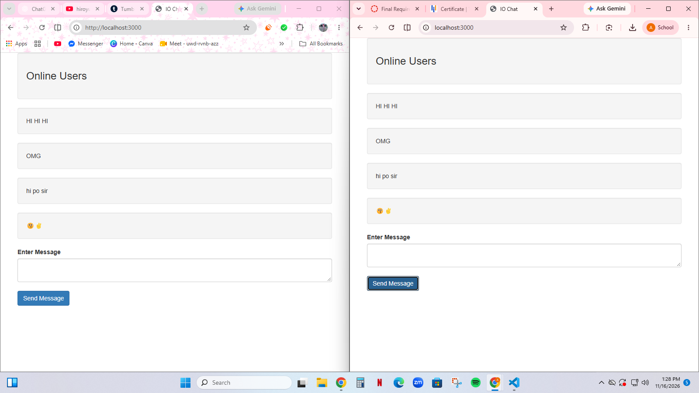

#IO Chat App (TypeScript)

Name: ANGELA BLAZE P. AGCAOILI
SECTION: BSCS-2A

What does this project do? 
It's a real-time web chat application built with TypeScript, Node.js, Express, and Socket.IO. 

Users can open the web interface and send messages that broadcast instantaneously to all connected devices/browsers.

How to Install and Run
1. Clone the repository:
   ```bash
   git clone <your-github-repo-url>
   cd CHATAPP
  
   ## Screenshot
